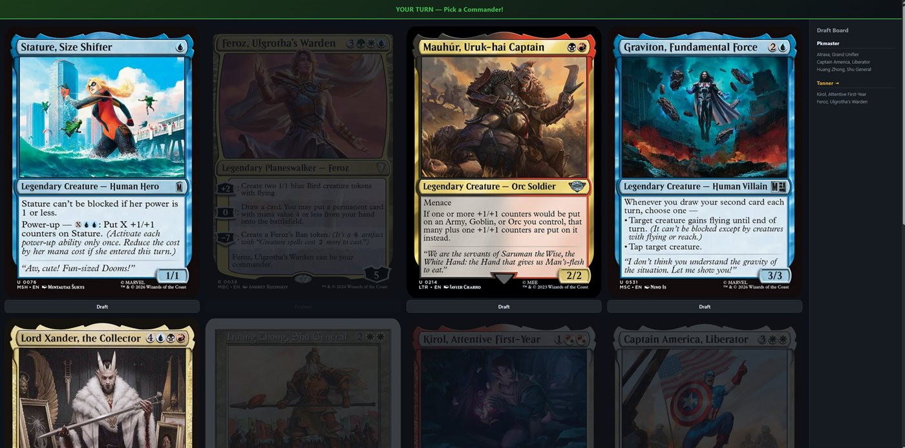
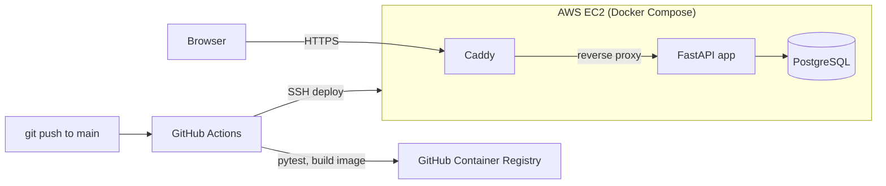

# MTG Commander Draft

A web app where Commander players run a snake draft of commanders with friends, then build decks from their picks.

**Live:** https://mtgcommanderdraft.duckdns.org



## Features

- Snake draft format (1-2-3-4-4-3-2-1)
- Share a room code so friends can join your draft
- Create a dynamic room size from 2 to 12 players
- Draft from any legal commander in Magic's history
- Ability to copy your choices and export as a decklist to popular deckbuilding websites such as Moxfield and Archidekt

## Architecture



- User accesses the site, hosted on the EC2 AWS Instance running a Docker Compose of our 3 containers: Caddy, the app, and Postgres
- Caddy receives the HTTPS traffic and forwards it to the app (FastAPI) over Docker's private network, the app builds the draft with data from the PostgreSQL database. The database is filled with info from Scryfall.
- When deploying, creating a pull request initiates a round of GitHub Actions tests. This runs a test suite where a virtual machine from GitHub installs our requirements and runs pytest. Should a test fail, the `protect-main` ruleset in GitHub security prevents a PR from being able to merge with main.
- On merge to main, GitHub Actions builds the image, pushes it to GHCR, connects to the server over SSH, and the AWS EC2 server pulls our newly built image and restarts

## Tech stack

- **Backend:** PostgreSQL, SQLAlchemy, FastAPI, Uvicorn
- **Frontend:** JavaScript, CSS, HTML
- **Infrastructure:** AWS EC2, Docker and Docker Compose, Caddy
- **Card Data:** Scryfall API
- **CI/CD:** GitHub Actions, GitHub Container Registry (GHCR), SSH deploy

## Run it locally

**PreReqs:** Docker Desktop, Git

Running the app:

1. Clone the repo onto your device and change directory:

    ```bash
    git clone https://github.com/Tanner-Dudley/MTG-Fantasy-Draft.git
    ```
    cd MTG-Fantasy-Draft

2. Create a `.env` file
    - On Windows in the command prompt:

        ```bash
        copy .env.example .env
        ```

    - On Mac/Linux:

        ```bash
        cp .env.example .env
        ```

3. Open the `.env` and replace the two `change-me` values, use this command to create the values:

    ```bash
    python -c "import secrets; print(secrets.token_hex(32))"
    ```

4. Start it! First start will be slow since it needs to initialize every legal commander

    ```bash
    docker compose up --build
    ```

5. Open at <http://localhost:8000>: Check it out for yourself
6. To stop, Ctrl + C in the terminal or run:

    ```bash
    docker compose down
    ```

7. `docker compose down -v` will delete the database. Which is needed to reseed the cards after a new set / expansion. Will also delete all users and lobbies

## Running tests

1. Create a virtual environment:

    ```bash
    python -m venv .venv
    ```

2. Activate the virtual environment:
    - On Windows in the command prompt:

        ```bash
        .venv\Scripts\activate
        ```

    - On Mac/Linux:

        ```bash
        source .venv/bin/activate
        ```

3. Run:

    ```bash
    pip install -r requirements-dev.txt
    ```

4. Run test suite:

    ```bash
    pytest
    ```

CI runs the tests on every PR, if a test fails, it does not allow merging to main.

## What I'd improve

- Changing the design from a Username / Password, to only screen names and room codes. This is to remove any personal data from needing to be stored and streamlining the process of initiating a draft
- More features
    - More draft customization, limit by set, release year, color, and rarity
- This app is a tool meant to be used by friends, and my local game store, so there is not a demand to scale. However, if I were to scale, I would move from Postgres to Amazon RDS for PostgreSQL. RDS handles automatic backups and patching, which protects against data loss, and its failover keeps a standby copy in another data center that takes over automatically, which removes the database as a single point of failure. I'd also replace the current polling with WebSockets.
- Integrate EDHREC data, implementing more data for players when drafting
